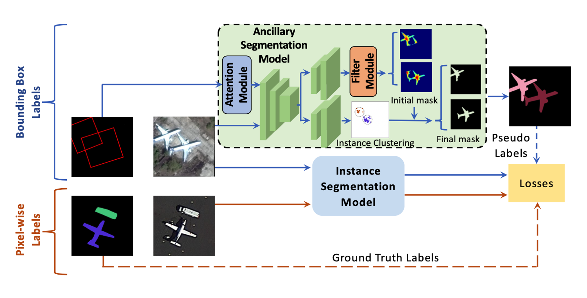

# Efficient Hybrid Supervision for Instance Segmentation in Aerial Images

> Linwei Chen, Ying Fu*, Shaodi You and Hongzhe Liu
>
> **Paper**: [*Efficient Hybrid Supervision for Instance Segmentation in Aerial Images*](https://www.mdpi.com/2072-4292/13/2/252), Remote Sensing 13(2):252, 2021.

Official implementation on the **iSAID** aerial dataset. This repo releases the training/evaluation code of the full hybrid-supervision pipeline, the **semantic-assistance model weights**, the **generated pseudo masks**, and the **verbatim evaluation logs of every experiment in the paper**.

This work was later extended into our Neurocomputing 2022 journal paper ([Hybrid Supervised Instance Segmentation by Learning Label Noise Suppression](https://github.com/Linwei-Chen/hybird_supervision_instance_segmentation)); the semantic branch code (`SpatialEmbeddings/`) is shared between the two repos.

**Abstract**

Instance segmentation in aerial images is of great significance for remote sensing applications, and it is inherently more challenging because of cluttered background, extremely dense and small objects, and objects with arbitrary orientations. Besides, current mainstream CNN-based methods often suffer from the trade-off between labeling cost and performance. To address these problems, we present a pipeline of hybrid supervision. In the pipeline, we design an ancillary segmentation model with the bounding box attention module and bounding box filter module. It is able to generate accurate pseudo pixel-wise labels from real-world aerial images for training any instance segmentation models. Specifically, bounding box attention module can effectively suppress the noise in cluttered background and improve the capability of segmenting small objects. Bounding box filter module works as a filter which removes the false positives caused by cluttered background and densely distributed objects. Our ancillary segmentation model can locate object pixel-wisely instead of relying on horizontal bounding box prediction, which has better adaptability to arbitrary oriented objects. Furthermore, oriented bounding box labels are utilized for handling arbitrary oriented objects. Experiments on iSAID dataset show that the proposed method can achieve comparable performance (32.1 AP) to fully supervised methods (33.9 AP), which is obviously higher than weakly supervised setting (26.5 AP), when using only 10% pixel-wise labels.



## Released artifacts

| Artifact | Notes | Link |
|---|---|---|
| Semantic assistance model (Spatial Embeddings, iSAID) | **AP 46.2 / AP50 78.9** — exceeds the 44.2 AP reported in the paper. The values are recorded in the checkpoint's own evaluation-time naming convention (as with all our saved checkpoints); they are not re-verified by the logs shipped here, which cover the training-stage evaluations of the semantic branch | [HuggingFace — link to be added] |
| Pseudo masks for the iSAID training set (`iSAID_pred_save`) | Generated by the semantic branch; used as pixel-level supervision for the detector | [HuggingFace — link to be added] |
| Verbatim per-run evaluation logs | `results/` in this repo — the source of every number in the paper | in this repo |

> **A note on detector weights**: the detector checkpoints of Table 2/3 were produced in 2020 and were not preserved in our archive (the same rotation pattern as our other projects); the preserved snapshots score below the published numbers. Following our release policy (*only release artifacts that match or exceed the paper*), detector weights are not included — the verbatim logs under `results/` document how each reported number was produced. The COCO-format annotation jsons consumed by the detector scripts (box / pseudo-mask mixes such as `obbox_mask.json`) are pipeline intermediate products and are not included; they are derived from the released pseudo masks and the iSAID box annotations.

## Framework

1. A semantic segmentation branch (Spatial Embeddings) is trained on the few pixel-labeled images and the box-derived pseudo labels.
2. The branch generates **pseudo masks** for the bounding-box-only images.
3. A Mask R-CNN detector is trained on the hybrid labels (pixel masks + pseudo masks + boxes), with the bounding-box attention/filter modules handling cluttered background and arbitrary orientations.

## Repository layout

```
detectron2_test.py            # launcher (iSAID experiments)
iSAID/                        # iSAID experiments: hbbox/obbox settings, genmask splits, 5%/20% ratios, finetune mixes
Mask-RCNN-iSAID*/             # Mask R-CNN baselines and Genmask variants on iSAID
Mask-RCNN-R50-x1/             # Mask R-CNN R50 baseline
Mask-RCNN-Genmask-*/          # Genmask variants and iteration tests
Faster-RCNN-iSAID/            # Faster R-CNN comparison
RetinaNet-iSAID/              # RetinaNet comparison
FCOS/                         # FCOS comparison (configs)
SpatialEmbeddings/            # semantic branch: training, pseudo-mask generation, evaluation
results/                      # verbatim per-run logs (exp_scripts/ + semantic branch result.txt)
```

Each experiment directory contains its own `detectron2_test.py` (training/evaluation launch script) and, where applicable, `eval.py`.

## Environment (historical, as verified in 2026)

- Python 3.6 / PyTorch 1.10.1 + CUDA 11.3
- detectron2 **v0.6** (built from source; the code was originally developed on a 2020-era fork)
- opencv, shapely, pycocotools
- The FCOS experiments additionally require [AdelaiDet](https://github.com/aim-uofa/AdelaiDet) (`adet`)

```bash
python -m pip install 'git+https://github.com/facebookresearch/detectron2.git@v0.6'
```

## Data

iSAID is distributed via its [official homepage](https://captain-whu.github.io/iSAID/) and is not redistributable: please download `instancesonly_filtered_train/val.json` and the image patches there. `val` = 9512 patches of 800×800 (official val split). The experiments read the data through `register_coco_instances` on the devkit jsons.

## Reproducing the paper numbers

Every directory under `results/exp_scripts/iSAID_runs/iSAID/` holds the verbatim `result.txt` of one experiment row where an evaluation was recorded (Mask-RCNN-0.05, Mask-RCNN-0.2, only_hbbox, only_obbox, obbox_finetune_*, hbbox/obbox genmask splits, ...). Two archived semantic-branch evaluation logs are shipped at the top of `results/`: the weakly-stage record (AP 22.8 / AP50 42.8) and an earlier-stage record (AP 12.3 / AP50 3.0).

## Citation

If you use our code for research, please ensure that you cite our paper:

```bibtex
@article{chen2021efficient,
  title={Efficient Hybrid Supervision for Instance Segmentation in Aerial Images},
  author={Chen, Linwei and Fu, Ying and You, Shaodi and Liu, Hongzhe},
  journal={Remote Sensing},
  volume={13},
  number={2},
  pages={252},
  year={2021},
  publisher={Multidisciplinary Digital Publishing Institute}
}
```

## Questions

If you have any questions, please email to chenlinwei@bit.edu.cn.

## License

Released for academic research use. iSAID annotations are registration-governed — do not redistribute.
